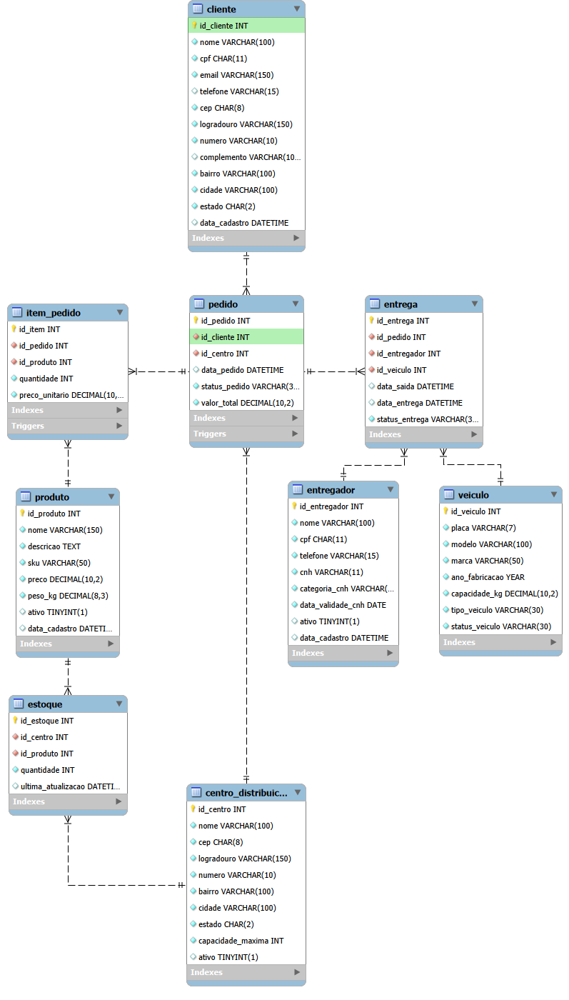

# LogiTrack — Sistema de Gerenciamento Logístico

Projeto de banco de dados relacional desenvolvido em **MySQL 8** para a empresa fictícia **NexCargo Transportes**.

O LogiTrack foi criado com o objetivo de organizar e relacionar informações de clientes, pedidos, produtos, centros de distribuição, estoque e entregas, utilizando recursos do SQL para automatizar operações e gerar relatórios gerenciais.

## Tecnologias utilizadas

- MySQL 8
- MySQL Workbench
- SQL

## Funcionalidades

- Cadastro e gerenciamento de clientes, produtos e pedidos.
- Controle de estoque por centro de distribuição.
- Registro de entregas, entregadores e veículos.
- Cálculo automático do valor total dos pedidos.
- Atualização automática do estoque ao inserir, alterar ou excluir itens de pedidos.
- Bloqueio de operações com estoque insuficiente.
- Restrição da alteração do centro de distribuição de pedidos que já possuem itens.
- Consultas e relatórios utilizando VIEWs.
- Operações reutilizáveis por meio de Stored Procedures.

## Modelagem do banco de dados

O banco de dados possui **9 tabelas**, relacionadas por chaves primárias e estrangeiras:

| Tabela | Responsabilidade |
|---|---|
| `cliente` | Armazena os dados dos clientes |
| `produto` | Contém as informações dos produtos |
| `centro_distribuicao` | Registra os centros de distribuição |
| `pedido` | Armazena os pedidos realizados |
| `item_pedido` | Relaciona os produtos aos pedidos |
| `estoque` | Controla a quantidade de cada produto por centro |
| `entregador` | Armazena os dados dos entregadores |
| `veiculo` | Registra os veículos utilizados |
| `entrega` | Relaciona pedidos, entregadores e veículos |

### Diagrama de relacionamentos



## VIEWs — Consultas e relatórios

Foram desenvolvidas **5 VIEWs** para facilitar a consulta e a análise dos dados.

| VIEW | Finalidade |
|---|---|
| `vw_relatorio_entregas` | Relatório detalhado das entregas |
| `vw_faturamento_cliente` | Total dos pedidos por cliente |
| `vw_clientes_acima_1000` | Clientes com faturamento superior a R$ 1.000 |
| `vw_entregas_pendentes` | Consulta de entregas pendentes |
| `vw_resumo_entregas` | Resumo das situações das entregas |

Exemplo de utilização:

```sql
SELECT *
FROM vw_relatorio_entregas;

SELECT *
FROM vw_faturamento_cliente;
```

## Triggers — Automações

O projeto utiliza **7 triggers** para automatizar operações e aplicar regras de negócio.

| Trigger | Responsabilidade |
|---|---|
| `trg_item_pedido_insert` | Recalcula o total após inserir um item |
| `trg_item_pedido_update` | Recalcula o total após atualizar um item |
| `trg_item_pedido_delete` | Recalcula o total após excluir um item |
| `trg_validar_estoque_insert` | Valida e desconta o estoque na inserção |
| `trg_atualizar_estoque_update` | Ajusta o estoque quando a quantidade de um item muda |
| `trg_devolver_estoque_delete` | Devolve ao estoque a quantidade de um item excluído |
| `trg_bloquear_troca_centro` | Impede a troca de centro de pedidos que possuem itens |

As triggers de inserção e atualização de itens utilizam condições diretamente no `UPDATE` do estoque para impedir descontos quando não existe quantidade suficiente.

## Stored Procedures

Foram implementadas **3 procedures** para facilitar operações recorrentes no banco.

| Procedure | Funcionalidade |
|---|---|
| `sp_cadastrar_pedido` | Cadastra um novo pedido |
| `sp_adicionar_item_pedido` | Adiciona um produto a um pedido |
| `sp_atualizar_status_entrega` | Atualiza o status de uma entrega |

### Exemplos de utilização

**Cadastrar um pedido:**

```sql
CALL sp_cadastrar_pedido(1, 2);
```

Cadastra um pedido para o cliente de ID 1, vinculado ao centro de distribuição de ID 2.

**Adicionar um item ao pedido:**

```sql
CALL sp_adicionar_item_pedido(3, 3, 5, 79.90);
```

Adiciona cinco unidades do produto de ID 3 ao pedido de ID 3, considerando o preço unitário informado.

As triggers são acionadas automaticamente para validar o estoque, descontar a quantidade e recalcular o valor total do pedido.

**Atualizar o status de uma entrega:**

```sql
CALL sp_atualizar_status_entrega(3, 'EM_TRANSITO');
```

Atualiza o status da entrega de ID 3. Os valores aceitos são `PENDENTE`, `EM_TRANSITO`, `ENTREGUE`, `FALHA_ENTREGA` e `CANCELADA`.

*Os exemplos são independentes e utilizam os IDs dos dados iniciais do projeto.*

## Estrutura do repositório

```text
LogiTrack/
├── 01_estrutura.sql
├── 02_dados.sql
├── 03_views.sql
├── 04_triggers.sql
├── 05_procedures.sql
├── README.md
└── imagens/
    └── diagrama_logitrack.png
```

## Como executar o projeto

**Pré-requisito:** MySQL 8. Recomenda-se utilizar o MySQL Workbench para executar os scripts.

1. Baixe ou clone este repositório.
2. Abra uma conexão com seu servidor MySQL.
3. Execute os arquivos SQL individualmente, respeitando a ordem abaixo:

| Ordem | Arquivo | Finalidade |
|---|---|---|
| 1 | `01_estrutura.sql` | Criação do banco de dados e das tabelas |
| 2 | `02_dados.sql` | Inserção dos dados iniciais |
| 3 | `03_views.sql` | Criação das VIEWs |
| 4 | `04_triggers.sql` | Criação das triggers |
| 5 | `05_procedures.sql` | Criação das stored procedures |

**Importante:** os dados iniciais devem ser inseridos antes da criação das triggers, conforme a organização dos scripts.

Após a instalação, selecione o banco:

```sql
USE logitrack;
```

Para consultar os relatórios:

```sql
SELECT * FROM vw_relatorio_entregas;

SELECT * FROM vw_faturamento_cliente;

SELECT * FROM vw_resumo_entregas;
```

## Objetivo do projeto

O LogiTrack foi desenvolvido como projeto de estudo e portfólio, com foco na aplicação prática de conhecimentos de banco de dados relacional.

Durante o desenvolvimento, foram trabalhados conceitos como modelagem de dados, relacionamentos, integridade referencial, JOINs, consultas SQL, VIEWs, triggers, stored procedures e regras de negócio.
